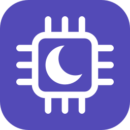
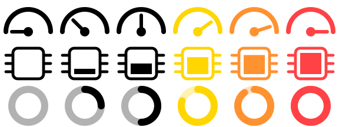

<p align="center">
  
</p>

<h1 align="center">RAM Limiter</h1>

<p align="center"><em>A memory limit for your browser.</em></p>

<p align="center">
  
  
  
</p>

<p align="center">
  <a href="#install">Install</a> &middot; <a href="#the-menu">Menu</a> &middot; <a href="#faq">FAQ</a> &middot; <a href="#privacy">Privacy</a>
</p>

A Mac menu bar app and browser extension that puts a memory limit on your browser. When the browser goes over the limit, the tab you haven't looked at for the longest time is **unloaded**: it stays in the tab bar, and loads again when you click it.

> **Protection isn't guaranteed.** RAM Limiter tries not to unload tabs with unsaved text, calls or uploads, but it can miss some. **For anything important, tick the site under Never unload. That is the safest option.**

This is an unofficial project. It isn't affiliated with Opera, Google, Microsoft, Brave or Vivaldi.
Only download RAM Limiter from its original GitHub repository; copies elsewhere may have been changed.

## Requirements

- macOS 14 (Sonoma) or newer. So far it has only been run on macOS 27 on an Apple silicon Mac. The download includes an Intel version, which is untested.
- One of these browsers:

| Browser | Status |
| --- | --- |
| Opera | Tested |
| Chrome | Tested |
| Edge, Brave, Vivaldi | Should work, untested |

Safari, Firefox and Windows aren't supported.

## Install

You need two parts: the **app** (the menu bar icon) and the **extension** (inside your browser). One download has both.

### 1. Get the app

1. Open the [latest release](../../releases/latest) and download `RAM-Limiter-….zip`.
2. Unzip it. You get a **RAM Limiter** folder.
3. Drag the **RAM Limiter** app into your **Applications** folder.
4. Move the **extension** folder somewhere it can stay, such as **Documents**. Your browser keeps using it from there, so don't delete or move it.

### 2. Open it the first time

macOS blocks the app at first, because it isn't notarized by Apple (that needs a paid developer account).

1. Open **RAM Limiter** from Applications. When the warning appears, click **Done**, not **Move to Bin**.
2. Open **System Settings → Privacy & Security** and scroll down.
3. Next to the message about RAM Limiter, click **Open Anyway**, then confirm.

You only do this once. The app appears in the menu bar at the top of the screen and has no Dock icon.

Only do this for a copy downloaded from this repository. If you'd rather not, [build it yourself](#build-it-yourself) from the code.

### 3. Add the extension to your browser

1. Open your browser's extensions page: `opera://extensions`, `chrome://extensions`, `edge://extensions`, `brave://extensions` or `vivaldi://extensions`.
2. Turn on **Developer mode**.
3. Click **Load unpacked** and choose the **extension** folder.
4. Click the RAM Limiter icon in the menu bar. Within about a minute it should say **extension: connected**.
5. Refresh any tabs that were already open, so calls and uploads in them can be detected.

Repeat for each browser you want to limit. If you use several profiles in one browser, add the extension to only one of them.

### Build it yourself

Instead of steps 1 and 2:

1. Download this project (**Code → Download ZIP**), unzip it, and put the folder somewhere it can stay.
2. Open **Terminal** and install Apple's command line tools. Skip this if you already have them.

   ```sh
   xcode-select --install
   ```

3. Type `cd `, drag the project folder into the Terminal window, and press Return.
4. Build and open the app:

   ```sh
   sh build.sh && open "RAM Limiter.app"
   ```

Then add the `extension` folder from the project, as in step 3 above.

## Default settings

| Setting | Default |
| --- | --- |
| Limiter on | On |
| Limit | 4 GB |
| Check intervals | 1 minute |
| Grace period | 3 minutes |
| Icon | Nap Chip |
| Protect unsaved text | On |
| Protect calls and uploads | On |
| Start at login | On |

**The limiter is on as soon as a browser connects**, so tabs can be unloaded if that browser is already over 4 GB.

## The menu

| Item | What it does |
| --- | --- |
| **Browser** | Chooses which browser the menu shows. It only appears when two or more browsers are listed. |
| **Limiter on** | Switches the limiter on or off for this browser. |
| **Limit** | 2 to 6 GB. |
| **Check intervals** | How often memory is checked and tabs are unloaded. Shorter intervals use more CPU; the menu shows an estimate for your Mac once it has measured one. |
| **Grace period** | How long a tab is safe after you leave it. |
| **Icon** | Nap Chip (the logo, which doesn't change), numbers, speedometer, memory chip, ring or the word RAM. |
| **Never unload** | Tick the sites that must stay loaded. |
| **Pause** | Stops this browser's limiter for 30 minutes, 1 hour or 2 hours. |
| **Protect unsaved text** | Keeps tabs where you've typed something you haven't sent. |
| **Protect calls and uploads** | Keeps tabs that are in a call or uploading a file. |
| **Start at login** | Opens the app when you sign in to your Mac. |
| **Log** | Lists unloaded tabs. Click one to go back to it. |

Everything from **Limiter on** to **Protect calls and uploads** is set separately for each browser. **Start at login**, **Log** and **Quit** apply to the whole app.

### Colours

<p align="center">
  
</p>

The icon turns **yellow** at 80% of your limit, **orange** at 90% and **red** at 100%. It looks faded when the limiter is off or paused. These colours and the live reading apply to every icon except **Nap Chip**, the default, which stays purple and white. Choose another icon to see your usage in the menu bar.

## Things that aren't obvious

- **Peek at a browser:** in the Browser list, rest the pointer on a browser to preview it. Click to keep it selected.
- **Removed a browser by accident?** Clicking **✕** removes it from the list and stops limiting it. To bring it back, **reload RAM Limiter on that browser's extensions page**. Its settings are kept.
- **The menu bar shows one browser:** the one you selected. Another browser can be over its limit without you seeing red, although its limiter still works.
- **Moon badge:** a tab unloaded by RAM Limiter gets a small purple moon on its icon. An unloaded tab **won't have the moon** if your browser unloaded it itself, if it was already unloaded before you installed RAM Limiter, or if the page blocks extensions (such as the browser's settings pages or its extension store).
- **It can stay over the limit:** if every remaining tab is protected, nothing more is unloaded.
- **Memory Freed Today** is an estimate.
- **Numbers may differ from Activity Monitor**, because memory shared between the browser's processes is counted once.

## Which tabs are never unloaded

- The tab you're looking at in each window.
- Pinned tabs.
- Tabs playing sound.
- Sites ticked under **Never unload**.
- Tabs inside the grace period.
- Tabs the browser has marked as not to be unloaded.

With the two protection options on, RAM Limiter also tries to keep:

- **Unsaved text:** text boxes you've typed in that still contain text. Search boxes and password fields are ignored.
- **Calls:** tabs using your camera or microphone, sharing your screen, or connected to a live audio or video call.
- **Uploads:** tabs sending files of about 256 KB or more, and for a minute afterwards.

### Limits of the protection

- Uploads made by a site's background processes may not be detected.
- Pages that extensions aren't allowed to enter can't be checked.
- Tabs opened before you installed or reloaded the extension may need a refresh.
- Unloading a tab loses anything the page hasn't saved.

**If losing it would matter, use Never unload.**

## FAQ

**Will my browser be slower?**
Switching to an unloaded tab takes as long as loading the page again. Tabs that stay loaded aren't changed.

**Do I lose my tabs?**
No. They stay in the tab bar. Anything a page hadn't saved is lost, which is why the protections and **Never unload** exist.

**Why is the browser still over the limit?**
Every remaining tab is protected, or one tab you're using needs a lot of memory by itself.

**Doesn't my browser already do this?**
Many browsers can put idle tabs to sleep, and some have their own limits. RAM Limiter adds a limit you choose, protection rules, a log and a live menu bar reading.

**Does it work on Windows?**
Not yet.

## Privacy

- The app and the extension talk to each other only on your Mac (`127.0.0.1`, port 47831). Nothing is sent to the developer or to any server.
- The app only answers this extension, running in a supported browser.
- The log keeps the title and address of up to 200 unloaded tabs, saved on your Mac. The list of open sites is not saved, except the ones you tick.
- The extension can read all pages. It needs this to detect unsaved text, calls and uploads, and to add the moon badge. To draw the badge it may load the site's own icon.

## Troubleshooting

| Problem | Try this |
| --- | --- |
| macOS says it can't verify the app | Follow [Open it the first time](#2-open-it-the-first-time). |
| **Extension: not connected** | Check the app is running, then reload the extension. Wait a minute. |
| **Error: port 47831 unavailable** | Quit any other copy of the app, then open it again. |
| Nothing is unloaded | Check the limiter is on, you're over the limit and the tabs aren't protected. |
| Start at login stopped working | If you moved the app, untick and tick **Start at login**. |

## Updating

Quit the app. Download the new version, replace the app in Applications and the contents of your **extension** folder, then open the app and reload the extension in each browser. macOS may ask you to allow the new version again.

If you built it yourself, download the new code into the same folder and run the build command again.

## Uninstall

1. Untick **Start at login**, then click **Quit**.
2. Remove RAM Limiter from each browser's extensions page.
3. Delete the app and the extension folder.
4. Optional: delete the saved settings and log:

   ```sh
   defaults delete local.opera-ram-limiter
   ```

## For developers

`node test.js` runs the extension's tests (needs Node.js). The app is in `app/main.swift`. `sh package.sh` makes the ready-made download in `dist/`, to attach to a release.

## License

[MIT](LICENSE)
